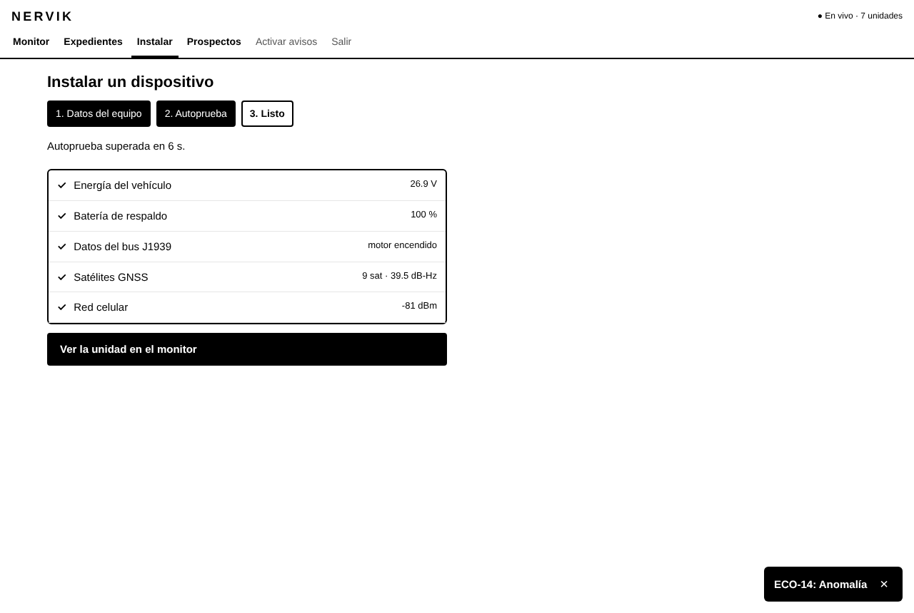
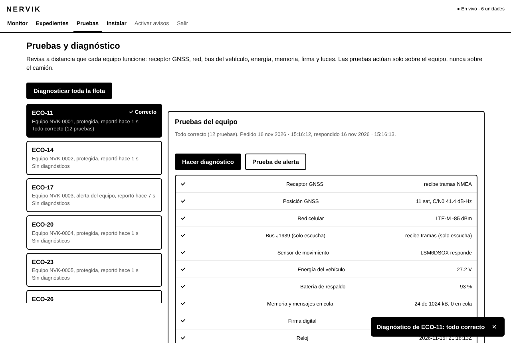
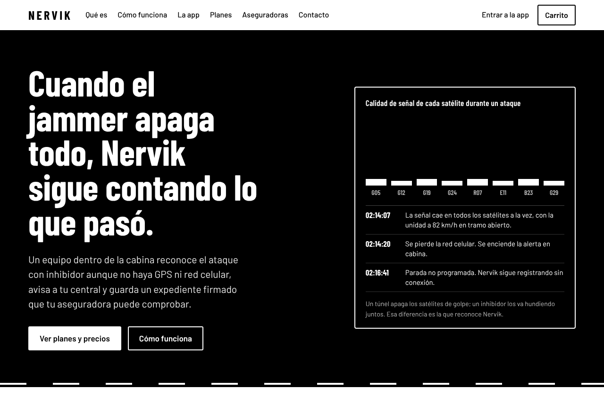

# Nervik

Software de Nervik, en tres partes con propósitos distintos:

- **Página web** (`/`): promoción y venta. Qué es Nervik, cómo funciona, la app, planes y precios, aseguradoras, preguntas, la bitácora del proyecto, canales de contacto, formulario «Contáctanos» y **tienda con carrito** (dispositivo + plan mensual).
- **App de monitoreo** (`/app`): el centro de control en tiempo real. Todas las unidades en carretera, alertas, expedientes firmados, **pruebas y diagnóstico a distancia** e instalación de equipos. Se vincula con el prototipo.
- **Firmware del prototipo** (`firmware/`): Raspberry Pi Pico W con GNSS, que se conecta a la app.

Además: la **API** que une todo, un **panel de ventas** para el equipo (`/admin`, pedidos y mensajes de la web) y un **simulador** de flota para trabajar sin hardware.

- **Instalar la app en el celular o la computadora:** [docs/instalar-app.md](docs/instalar-app.md)
- **Armar el prototipo y conectarlo a la app y la web:** [docs/prototipo.md](docs/prototipo.md)

Proyecto de Ingeniería IV · Equipo 2 · IBERO Puebla

## Requisitos

- Node.js 22.13 o superior (`node -v`)
- Nada más: la base de datos es SQLite integrada en Node.

## Arrancar en tu computadora

```bash
npm install
npm run prototipo    # web: http://localhost:3000   app: http://localhost:3000/app   ventas: http://localhost:3000/admin
```

La llave de la central en local es `dev-central`. Para ver la app con muchas unidades sin hardware, en otra terminal:

```bash
npm run simular      # 6 unidades, historial de 60 días y un ataque cada 75 s
```

Para programar con recarga automática: `npm run dev` (API :3000 · app http://localhost:5173/app · web :8080).

Para abrir la app desde el celular, conéctalo a la misma red Wi-Fi y entra a la dirección `Network` que imprime Vite (por ejemplo `http://192.168.1.20:5173`).

## Qué ver en la demostración

1. **Monitor** en estado normal: todas las unidades «Protegida» y las zonas de riesgo sobre el mapa.
2. A los ~20 s el simulador lanza un ataque: la franja superior se pone negra con la **alerta temprana** (N1–N2), que el equipo alcanza a mandar antes de perder la red.
3. La unidad se queda sin señal. A los 45 s la central la marca como **«Sin señal · posible inhibidor»** con su última posición válida, aunque el equipo ya no pueda transmitir.
4. Al minuto regresa la señal y llega el **expediente firmado**. En **Expedientes** se abre la línea de tiempo y el botón **Verificar en este navegador** comprueba la firma sin depender del servidor.
5. En **Pruebas**, **Hacer diagnóstico** revisa cada parte del equipo a distancia.
6. En la web, agrega unidades al carrito y confirma un pedido; aparece en `/admin` con su folio.

## Estructura

| Carpeta | Qué contiene |
|---|---|
| `api/` | Node.js + Express. Verificación de firmas, contador anti-reenvío, cadena de expedientes, tiempo real (SSE), zonas de riesgo, órdenes de diagnóstico, catálogo, pedidos y contacto. Pruebas en `api/test/`. |
| `app/` | React + Vite, PWA. Monitor en tiempo real, detalle de unidad, expedientes, pruebas y diagnóstico, instalación en 3 pasos. |
| `web/` | Página de promoción y venta (HTML/CSS/JS sin dependencias): carrito en `carrito.html`, panel de ventas en `admin/`. **Los canales de contacto se llenan en `web/contacto.js`.** |
| `firmware/` | Firmware del prototipo (PlatformIO, Raspberry Pi Pico W o Pico + SIM7080G): GNSS, detección N0–N3, firma, cola sin red, LED, botones y simulacro. |
| `simulador/` | Gemelo digital de los dispositivos y referencia del protocolo para el firmware. |
| `docs/` | `instalar-app.md`, `prototipo.md`, `protocolo.md` (contrato con el firmware) y `arquitectura.md`. |
| `render.yaml` | Despliegue en Render con una dirección https (web, app y API juntas). |

## Comandos útiles

```bash
npm test                  # pruebas de la API (firma, reenvío, cadena, unidad muda, formulario)
npm run build             # compila la app para producción (app/dist)
npm run tunel             # dirección https temporal para instalar la app en el celular
npm run reiniciar-datos   # borra la base de datos y las llaves del simulador
```

## Variables de entorno

Copia `.env.example` y ajusta. Lo importante para producción es cambiar `CENTRAL_API_KEY` y, con el periodo real del firmware (30 s), subir `UMBRAL_MUDA_S` a 90.

## Capturas






Los mapas se ven en gris en las capturas porque se tomaron sin acceso a OpenStreetMap; en tu computadora cargan las calles.
