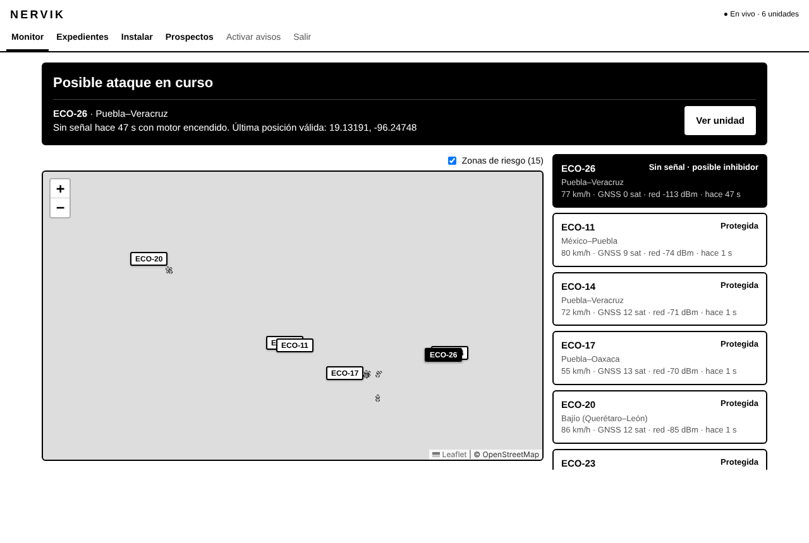
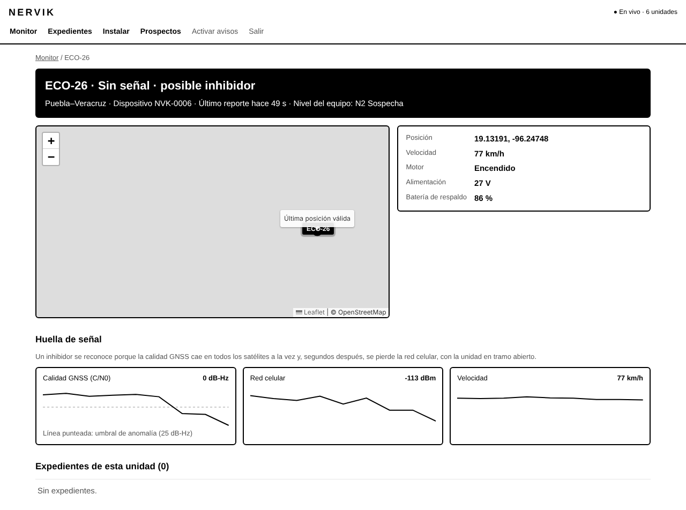

# Nervik

Software de Nervik: la **app del centro de control**, la **API** que recibe la evidencia firmada de los dispositivos y la **página web B2B**. Incluye un **simulador** de flota para trabajar sin hardware.

Proyecto de Ingeniería IV · Equipo 2 · IBERO Puebla

## Requisitos

- Node.js 22.13 o superior (`node -v`)
- Nada más: la base de datos es SQLite integrada en Node.

## Arrancar en tu computadora

```bash
npm install
npm run dev          # API :3000 · app :5173 · web :8080
```

En otra terminal, la flota simulada:

```bash
npm run simular      # 6 unidades, historial de 60 días y un ataque cada 75 s
```

- App del centro de control: http://localhost:5173 (llave de desarrollo: `dev-central`)
- Página web: http://localhost:8080

Para abrir la app desde el celular, conéctalo a la misma red Wi-Fi y entra a la dirección `Network` que imprime Vite (por ejemplo `http://192.168.1.20:5173`).

## Qué ver en la demostración

1. **Monitor** en estado normal: todas las unidades «Protegida» y las zonas de riesgo sobre el mapa.
2. A los ~20 s el simulador lanza un ataque: la franja superior se pone negra con la **alerta temprana** (N1–N2), que el equipo alcanza a mandar antes de perder la red.
3. La unidad se queda sin señal. A los 45 s la central la marca como **«Sin señal · posible inhibidor»** con su última posición válida, aunque el equipo ya no pueda transmitir.
4. Al minuto regresa la señal y llega el **expediente firmado**. En **Expedientes** se abre la línea de tiempo y el botón **Verificar en este navegador** comprueba la firma sin depender del servidor.
5. El formulario de la web aparece en **Prospectos**.

## Estructura

| Carpeta | Qué contiene |
|---|---|
| `api/` | Node.js + Express. Verificación de firmas, contador anti-reenvío, cadena de expedientes, tiempo real (SSE), zonas de riesgo, prospectos. Pruebas en `api/test/`. |
| `app/` | React + Vite, PWA. Monitor, detalle de unidad, expedientes, instalación con autoprueba, prospectos. |
| `web/` | Página de venta en HTML/CSS. Se puede publicar tal cual en GitHub Pages. |
| `simulador/` | Gemelo digital de los dispositivos y referencia del protocolo para el firmware. |
| `docs/` | `protocolo.md` (contrato con el firmware) y `arquitectura.md` (decisiones y pendientes). |

## Comandos útiles

```bash
npm test                  # pruebas de la API (firma, reenvío, cadena, unidad muda, formulario)
npm run build             # compila la app para producción (app/dist)
npm run reiniciar-datos   # borra la base de datos y las llaves del simulador
```

## Variables de entorno

Copia `.env.example` y ajusta. Lo importante para producción es cambiar `CENTRAL_API_KEY` y, con el periodo real del firmware (30 s), subir `UMBRAL_MUDA_S` a 90.

## Capturas





Los mapas se ven en gris en las capturas porque se tomaron sin acceso a OpenStreetMap; en tu computadora cargan las calles.
