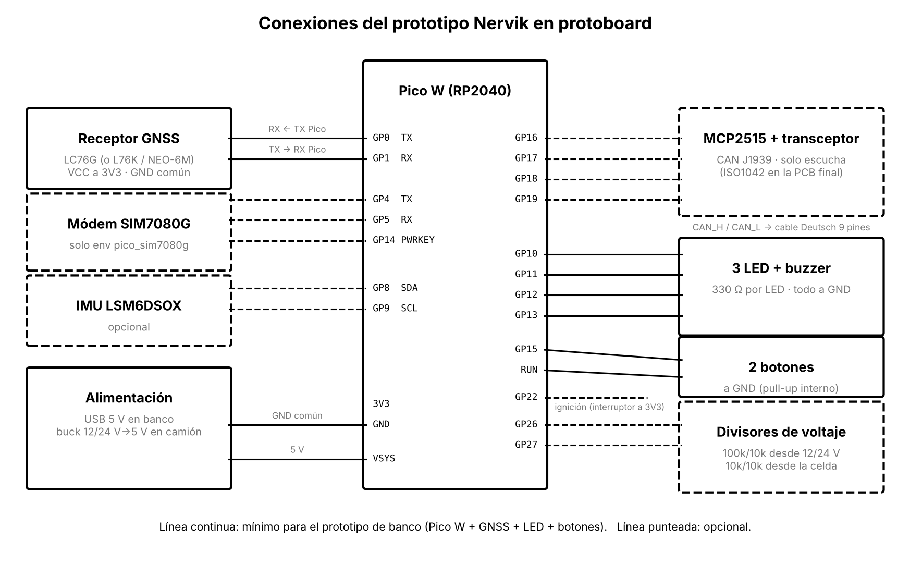

# Prototipo en protoboard y su conexión con la app y la web

Este es el prototipo de función que quedó como siguiente hipótesis en el reporte de la semana 8: comprobar que el receptor GNSS distingue la caída simultánea de C/N0 de un túnel o un puente, **sin usar inhibidores, que son ilegales**. Usa la arquitectura del PDS y del BOM de las semanas 7 y 8 (RP2040, GNSS LC76G, MCP2515, LSM6DSOX, SIM7080G, 3 LED y 2 botones), montada en protoboard.

## Qué se conecta con qué

```
Pico W (firmware/)  ──Wi-Fi o SIM7080G──►  API (npm run prototipo)  ◄──►  App de monitoreo (/app)
```

El prototipo firma cada mensaje con su propia llave y la app lo muestra como una unidad más: posición, señal, alertas, expedientes y **pruebas a distancia**. La página web (/) es solo de promoción y venta; no se conecta al prototipo.

## Material

**Mínimo para el banco:** Raspberry Pi Pico W, receptor GNSS con salida NMEA (el LC76G del BOM; sirve un L76K o NEO-6M/M8N con antena), 3 LED con resistencias de 330 Ω, buzzer pasivo, 2 botones, protoboard y cable USB.

**Opcional:** módulo MCP2515 con transceptor (bus J1939), IMU LSM6DSOX, módulo SIM7080G con SIM 1NCE (en ese caso basta una Pico sin W) y divisores de voltaje para medir alimentación y batería.



| Pico | Va a | Notas |
|---|---|---|
| GP0 / GP1 | RX / TX del GNSS | UART0; GNSS a 3V3 y GND |
| GP4 / GP5 / GP14 | RX / TX / PWRKEY del SIM7080G | UART1. Si usan el HAT Pico-SIM7080G de Waveshare, ese HAT ocupa GP0/GP1: cambien los pines en `include/pines.h` |
| GP8 / GP9 | SDA / SCL de la IMU | I2C0 |
| GP10, GP11, GP12 | LED de energía, comunicación y alerta | ánodo al pin, cátodo con 330 Ω a GND |
| GP13 | buzzer pasivo | el otro pin a GND |
| GP15 | botón de prueba/estado | el otro pin a GND |
| RUN | botón de reinicio | el otro pin a GND |
| GP16–GP19 | MISO, CS, SCK, MOSI del MCP2515 | SPI0; el módulo a 5 V solo si su lógica tolera 3.3 V |
| GP22 | interruptor de ignición a 3V3 | solo si `MOTOR_SIEMPRE_ENCENDIDO 0` |
| GP26 / GP27 | divisores de alimentación y batería | opcionales |

## Cargar el firmware

1. Instalen **VS Code** y la extensión **PlatformIO IDE**.
2. Abran la carpeta `firmware/` del repositorio.
3. Copien `include/config.example.h` como `include/config.h` y llenen:
   - `API_URL`: la dirección de la computadora que corre la API, por ejemplo `http://192.168.1.20:3000` (en Windows se ve con `ipconfig`, en Mac con `ipconfig getifaddr en0`). Si ya la desplegaron en Render, la URL `https://…onrender.com`.
   - `WIFI_SSID` y `WIFI_PASS`: la red del laboratorio o el hotspot del celular. La computadora y la Pico deben estar en la misma red si usan la IP local.
   - `GNSS_BAUD`: 9600 para L76K/NEO-6M, 115200 para LC76G.
4. Conecten la Pico manteniendo presionado **BOOTSEL** la primera vez y den **Upload** (flecha) en la barra de PlatformIO, con el entorno `pico_w_wifi` (Wi-Fi) o `pico_w_sim7080g` (la misma Pico W con el módem SIM7080G). Con una **Pico 2 W** usen `pico2_w_wifi` o `pico2_w_sim7080g`: tiene los mismos pines.
5. Abran el **Serial Monitor** (enchufe) a 115200. Al arrancar se imprimen el **código QR**, el **código de alta** `NVK1:NVK-P001:…` y la llave pública.

Comandos del monitor serie: `alta` (vuelve a mostrar el QR), `estado`, `diagnostico`, `simulacro`, `vaciar-cola`, `nueva-llave SI`.

## Darlo de alta en la app

1. En la computadora: `npm install` y luego `npm run prototipo`. Queda todo en una sola dirección: página web en `http://localhost:3000` y app en `http://localhost:3000/app` (llave `dev-central`).
2. En la app: **Instalar → paso 1**, escaneen el QR del monitor serie o peguen el código de alta. Escriban la unidad (por ejemplo `PROTO-1`).
3. **Paso 2:** conecten la Pico (en el camión sería el cable de 9 pines y los dos cinchos) y den **Ya está conectado**.
4. **Paso 3:** la prueba automática revisa satélites y red en unos 10 s. Energía, batería y bus aparecen como «no instalado» si no conectaron esos módulos y no bloquean la prueba.

La antena GNSS necesita ver el cielo: junto a una ventana funciona; en interiores el receptor no tendrá posición y la prueba de satélites no pasa.

## Demostración en clase (simulacro)

Mantengan presionado el **botón de prueba 3 s** (o escriban `simulacro` en el monitor serie). Durante unos dos minutos el firmware recrea la huella de un ataque, sin emitir nada:

| Segundo | Qué pasa | Qué se ve |
|---|---|---|
| 0–12 | El C/N0 baja 1.1 dB/s en todos los satélites | LED de alerta lento; la app pasa a **N1** |
| 14 | El nivel de la señal celular cae 20 dB | Buzzer; **N2**, alerta temprana enviada |
| 18 | Deja de transmitir (como con jammer) | Los mensajes se guardan en la flash |
| ~63 | La central no recibe nada con motor encendido | App: **«Sin señal · posible inhibidor»** |
| 85 | Detenido 60 s con motor encendido | LED de alerta fijo, **N3** |
| 100–120 | Regresan GNSS y red | Se envía la cola en orden y llega el **expediente firmado** |

También se puede iniciar desde la app: **Pruebas → Prueba de alerta**. Todo lo que se genera va marcado como **SIMULACRO** en la app y en el expediente, y no cuenta para las zonas de riesgo. El LED de energía parpadea mientras dura.

## Pruebas y diagnóstico desde la app

En **Pruebas** (o en el detalle de cada unidad) el botón **Hacer diagnóstico** manda la orden al equipo. La orden viaja en la respuesta a su siguiente reporte (máximo 10 s en el prototipo) y el equipo contesta con un mensaje firmado que revisa: receptor GNSS, posición, red, bus J1939, IMU, energía, batería, memoria y cola, firma digital, reloj, luces y buzzer (destellan para confirmarlo a simple vista) y el estado de la detección. Lo que no está conectado aparece como «no instalado». **Diagnosticar toda la flota** lo pide a todos los equipos a la vez. La pulsación corta del botón de prueba de la Pico hace el mismo diagnóstico y el resultado también aparece en la app.

Las órdenes solo actúan sobre el equipo, nunca sobre el vehículo (requisito I-02).

## Prueba real de la hipótesis (sin inhibidor)

- **Degradación gradual:** acerquen poco a poco una lata o caja metálica sobre la antena GNSS. El C/N0 baja en todos los satélites como con ruido; debe subir a N1.
- **Túnel:** cubran la antena de golpe con la caja cerrada. Los satélites desaparecen de un segundo a otro; no debe haber alarma si la cubren menos de 2 min.
- **Manejo en ciudad (F-02):** con el hotspot del celular, 30 minutos en carro pasando bajo puentes. Después, en la app, **Unidad → Descargar datos crudos (CSV)** y cuenten las falsas alarmas. Ese CSV es también el primer conjunto de datos para entrenar el modelo TinyML.

## Lo que falta validar con hardware

- El firmware compila para ambos entornos (`pico_w_wifi` y `pico_sim7080g`) y la criptografía se verificó contra la API (`firmware/test/host`). Lo que no se pudo probar sin las piezas: el arranque del SIM7080G con su APN, la lectura de un bus J1939 real y los umbrales de la IMU.
- El PDS pedía HMAC-SHA256 por evento (P-04). Se cambió a firma **ECDSA P-256** porque con HMAC la aseguradora necesitaría la llave secreta para verificar; con firma le basta la llave pública. Conviene actualizar el PDS.
- En producción la llave privada debe ir en un elemento seguro o en flash cifrada; en el prototipo vive en la flash de la Pico.

## Pruebas en la computadora

```bash
cd firmware && pio run                      # compila (Pico W)
cd test/host
g++ -I../../.pio/libdeps/pico_w_wifi/micro-ecc -o /tmp/pc prueba_cripto.cpp ../../src/sha256.c ../../.pio/libdeps/pico_w_wifi/micro-ecc/uECC.c
node verificar.mjs                          # la API acepta lo que firma el firmware
g++ -std=c++17 -I. -o /tmp/pd prueba_deteccion.cpp ../../src/deteccion.cpp && /tmp/pd   # túnel, ataque, sin cobertura
```
